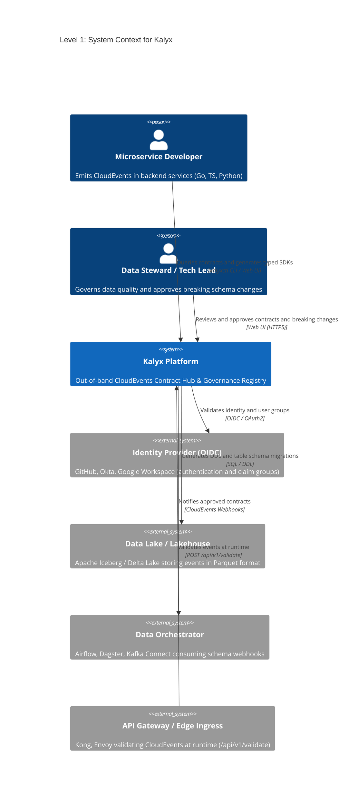
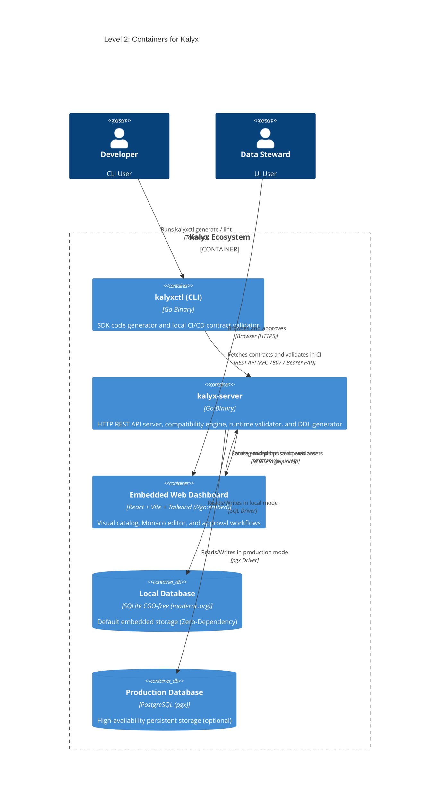
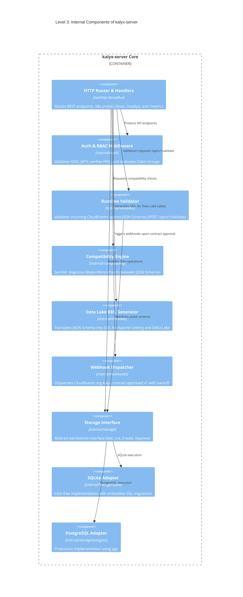

# Kalyx: C4 Architectural Model 🏛️🌸

This document defines the technical architecture of **Kalyx** following the **C4 standard (Context, Containers, Components, Code)** using **Mermaid** diagrams.

---

## Level 1: System Context Diagram
Shows users and external systems interacting with Kalyx across the organization.

---

## Level 2: Container Diagram
Shows high-level deployable units and physical architecture of Kalyx.

---

## Level 3: Component Diagram (Server Core)
Shows the internal decoupled package architecture inside the `kalyx-server` binary.

